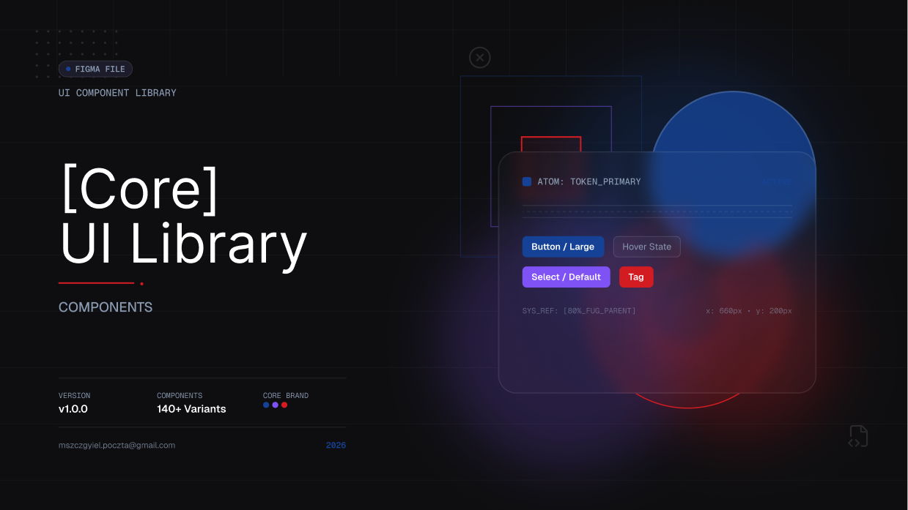

<p align="center">
  
</p>

<p align="center">
  Design tokens, icons and UI components for web applications.<br>
  Every component exists twice, with one behaviour and one look: as a web component for any framework, or none, and as a React component.
</p>

<p align="center">
  <a href="https://mszczygiel-projects.github.io/ui-core-library/"><b>Documentation</b></a> ·
  <a href="https://www.chromatic.com/builds?appId=6aec504fcea7cbc4ea05bbb1">Chromatic</a> ·
  <a href="https://www.figma.com/design/BzqkruN7r8mwWfFReznc83">Figma: UI Library</a> ·
  <a href="https://www.figma.com/design/Xxn0guDvAfyIqEKB6kADE9">Figma: Foundations</a> ·
  <a href="https://www.figma.com/design/lRdwn99eZTt6gCFeqc2Seh">Figma: Icons</a>
</p>

<p align="center">
  <a href="https://github.com/mszczygiel-projects/ui-core-library/actions/workflows/ci.yml"></a>
  <a href="https://github.com/mszczygiel-projects/ui-core-library/actions/workflows/storybook.yml"></a>
</p>

## Packages

| Package                                       | Contents                                                       |
| --------------------------------------------- | -------------------------------------------------------------- |
| `@mszczygiel-projects/ui-core-foundations`    | design tokens as CSS, Tailwind and TypeScript, and a token CLI |
| `@mszczygiel-projects/ui-core-icons`          | icons as SVG strings, and an icon CLI                          |
| `@mszczygiel-projects/ui-core-web-components` | web components, written with Stencil                           |
| `@mszczygiel-projects/ui-core-react`          | React components                                               |
| `@mszczygiel-projects/ui-core-shared`         | what both component packages share                             |

## Use the library

Install the tokens and the components of your framework:

```sh
pnpm add @mszczygiel-projects/ui-core-foundations @mszczygiel-projects/ui-core-react
# or, for any other framework or none
pnpm add @mszczygiel-projects/ui-core-foundations @mszczygiel-projects/ui-core-web-components
```

[Getting started](https://mszczygiel-projects.github.io/ui-core-library/?path=/docs/guides-getting-started--docs) loads the tokens, renders the first component and sets the theme. [Configuration](https://mszczygiel-projects.github.io/ui-core-library/?path=/docs/guides-configuration--docs) translates the texts the components render and sets the locale.

## Develop the library

With Node.js 24 and Corepack:

```sh
corepack enable
pnpm install
pnpm --filter @mszczygiel-projects/ui-core-storybook exec playwright install chromium
pnpm nx run storybook:storybook
```

The documentation site opens at `http://localhost:6006`. [The setup guide](docs/guides/setup.md) covers the rest of the first run and the commands, and [CONTRIBUTING.md](CONTRIBUTING.md) the way of working.

## Where to read

| You want to                               | Read                                                                                                                                                                                                                     |
| ----------------------------------------- | ------------------------------------------------------------------------------------------------------------------------------------------------------------------------------------------------------------------------ |
| use the library                           | [the documentation site](https://mszczygiel-projects.github.io/ui-core-library/): guides, foundations, components                                                                                                        |
| design with it                            | the Figma libraries: [UI Library](https://www.figma.com/design/BzqkruN7r8mwWfFReznc83), [Foundations](https://www.figma.com/design/Xxn0guDvAfyIqEKB6kADE9), [Icons](https://www.figma.com/design/lRdwn99eZTt6gCFeqc2Seh) |
| know how the library is developed         | [CONTRIBUTING.md](CONTRIBUTING.md)                                                                                                                                                                                       |
| change tokens, icons, components or Figma | [the guides](docs/guides/README.md)                                                                                                                                                                                      |
| know why something is the way it is       | [the decisions](docs/decisions/README.md)                                                                                                                                                                                |
| work on it as an agent                    | [AGENTS.md](AGENTS.md)                                                                                                                                                                                                   |
